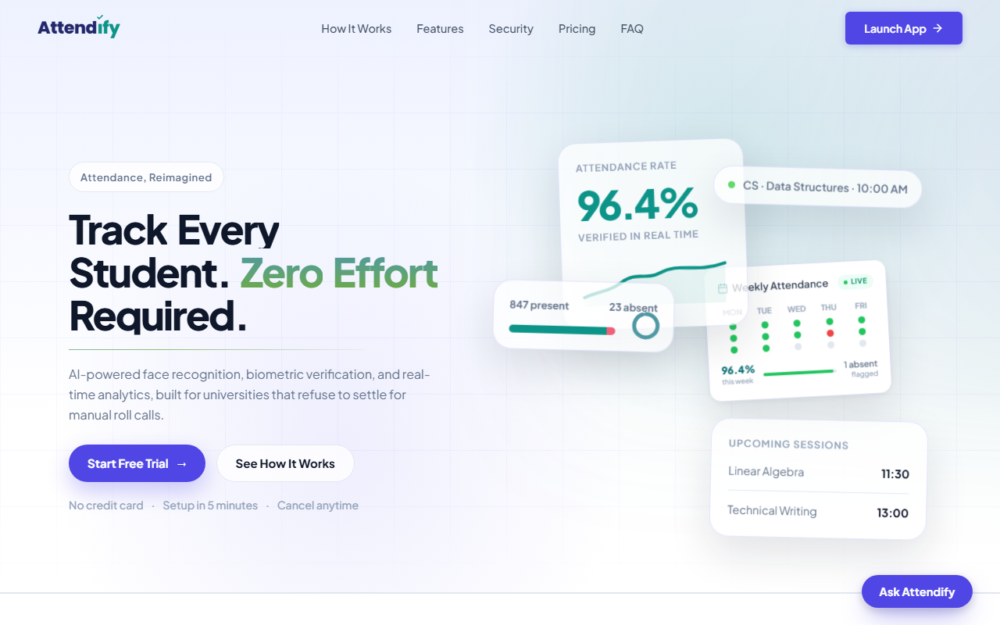
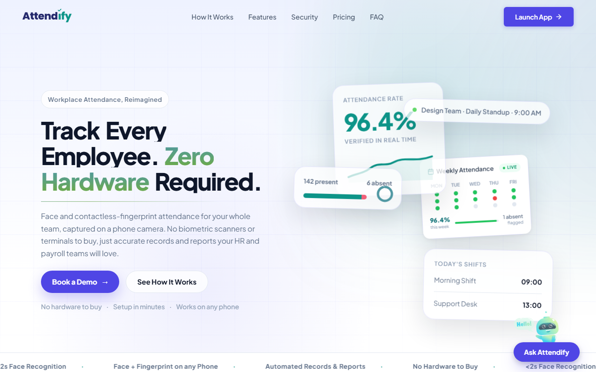
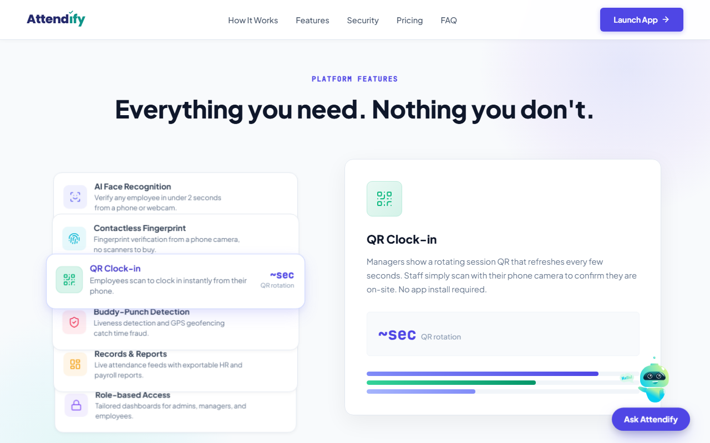
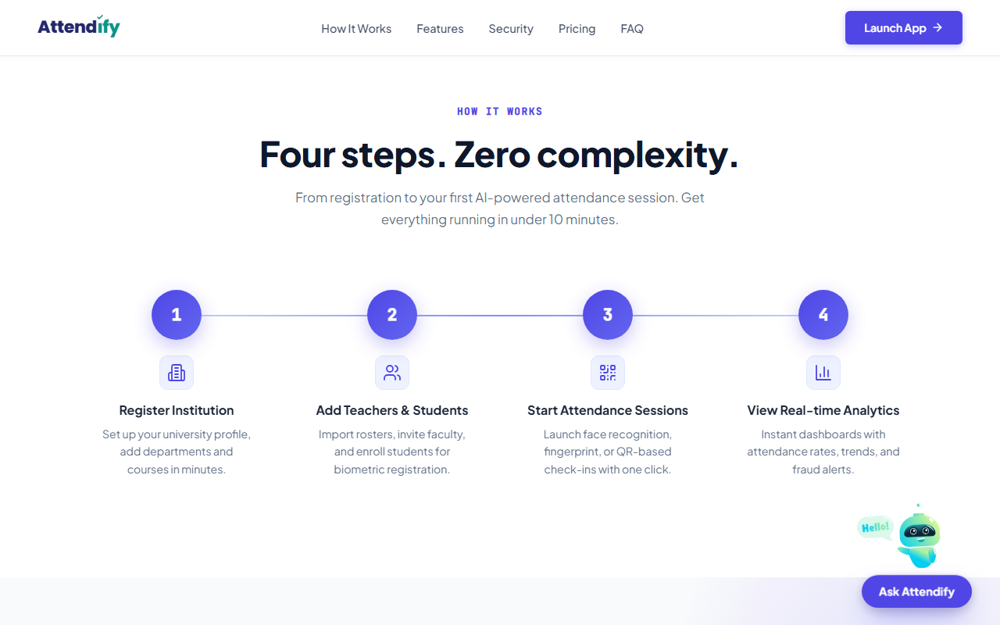
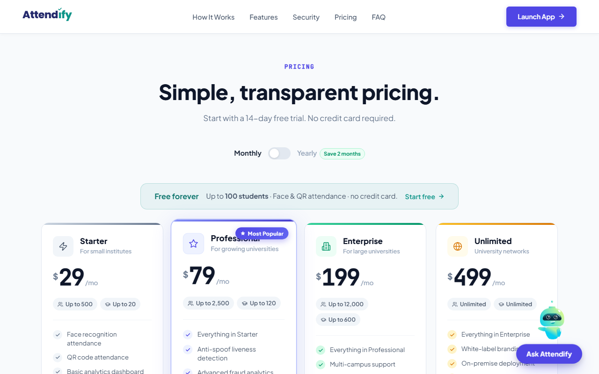
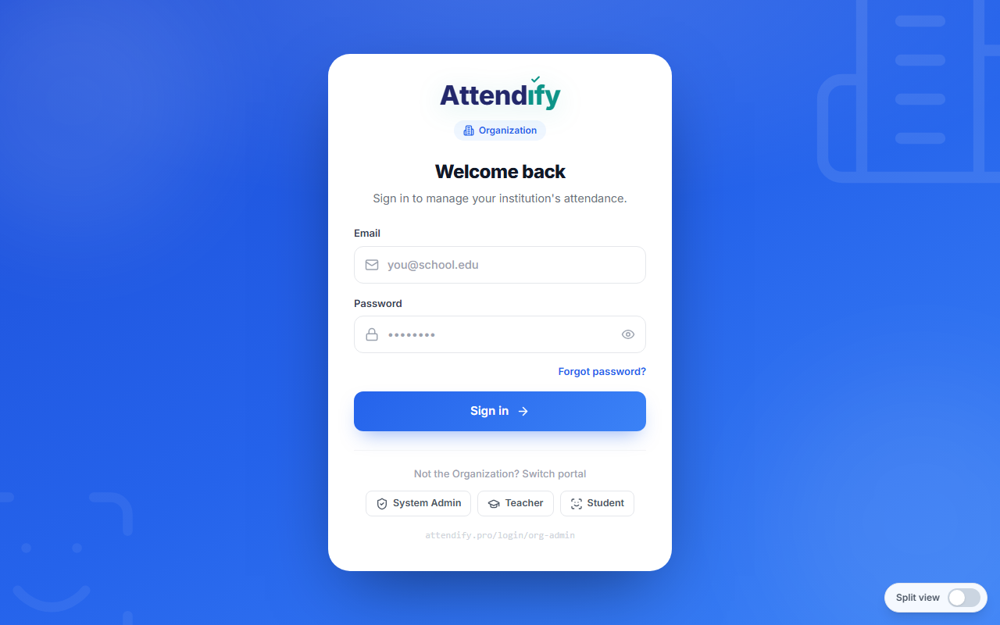
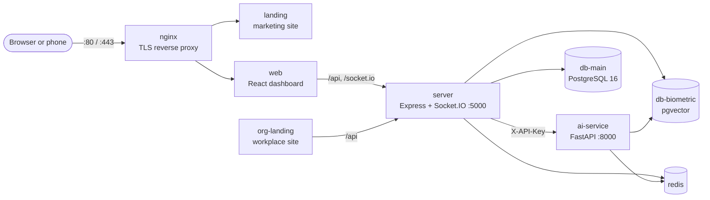

# Attendify

Attendance that checks who is actually in the room, using face and fingerprint scans from an ordinary phone camera.



**Live:** [attendify.pro](https://attendify.pro) (universities) · [org.attendify.pro](https://org.attendify.pro) (workplaces)

## What it does

Roll calls waste class time, and QR-only or sign-in-sheet attendance is easy to fake: a friend scans the code or signs for you. I built Attendify to stop that without buying any hardware.

A student opens the web app on their own phone and proves three things: **who** they are (face plus a contactless fingerprint read by the rear camera), that they are **live** (not a photo or a video), and that they are **here** (live QR on the teacher's screen, GPS geofence, device check). Teachers see check-ins arrive in real time, and anything suspicious becomes a fraud alert.

**The headline feature:** fingerprint capture with no scanner. The student holds a fingertip close to the phone's rear camera with the flash on. The app coaches them into focus and captures automatically, and the AI service turns the photo into a scanner-like ridge map and matches it. Face verification runs from the same camera, so there is nothing to install or buy.

It is a multi-tenant SaaS: each institution gets its own admins, teachers, students, courses and reports, isolated from every other tenant.

## How it works

Six independent checks. Teachers choose which ones a session requires.

| Layer | Check | What it stops | How |
|---|---|---|---|
| 1 | **Face match** | Someone else checking in for you | 3 to 5 frames, then an ArcFace (InsightFace `buffalo_l`) 512-d embedding, then a cosine search in pgvector (HNSW), with a margin guard against look-alikes |
| 2 | **Contactless fingerprint** | Borrowed faces and look-alikes | Phone rear camera + flash. The server enhances the photo into a ridge map (CLAHE, orientation field, Gabor filter bank), then matches it 1:1 against the student's enrolled samples with AKAZE keypoints and RANSAC |
| 3 | **Liveness** | Printed photos, screen replays, videos | Random challenges (turn left/right, smile, look up/down) checked with MediaPipe in HMAC-signed, short-lived sessions, plus passive texture/depth/motion anti-spoofing and a static-frame replay check |
| 4 | **Rotating QR** | Checking in from a forwarded screenshot | The teacher's screen shows an HMAC token that changes every few seconds. Scanning it issues a signed 3-minute presence pass that the biometric step must carry |
| 5 | **GPS geofence** | Checking in from home | Haversine distance to the session or course location. Outside the radius means rejected, and a fraud alert is raised |
| 6 | **Device check** | One phone marking several students | The browser's device fingerprint and IP are compared with other check-ins in the same session. A match raises a fraud alert |

## Features

- **Face + contactless fingerprint** from the phone or laptop the student already has. No scanners, no kiosks.
- **Liveness and anti-spoofing** on every biometric check-in.
- **Rotating QR presence gate**, **GPS geofencing** and **device/IP checks**, each optional per session.
- **Fraud alerts** with evidence (distance, device, confidence), in-app notifications and email.
- **Four roles:** system admin, organization admin, teacher and student, with strict tenant isolation.
- **Real-time dashboards** over Socket.IO, attendance reports and CSV exports, bulk user import.
- **Plans and limits** per institution, plus a public sign-up and approval flow for new organizations.
- **Public API** with scoped API keys, per-key rate limits, HMAC-signed webhooks and an OpenAPI reference ([integration guide](docs/API-Integration-Guide.md)).
- **Separate biometric database:** face embeddings and fingerprint ridge templates live in their own pgvector store. Raw camera frames are not stored, and students can delete their biometric data.
- **Landing-page assistant** powered by Llama 3.3 70B on Groq.
- **Ops basics:** health, readiness and metrics endpoints, cron jobs (session expiry, embedding cleanup, uptime alerts), nightly database backups.

## Screenshots

| | |
|---|---|
|  |  |
| Workplace edition at org.attendify.pro | Face, contactless fingerprint and QR, all from a phone |
|  |  |
| Four steps from sign-up to first session | Plans for universities |
|  | |
| One login page per role | |

## Tech stack

| Layer | Technology |
|---|---|
| Dashboard (`apps/web`) | React 18, TypeScript, Vite, Tailwind CSS, Radix UI, Zustand, Recharts, Socket.IO client, FingerprintJS, MediaPipe Tasks |
| Marketing sites (`apps/landing`, `apps/org-landing`) | React 18, TypeScript, Vite, CSS Modules, Framer Motion |
| API (`server`) | Node.js 20, Express, TypeScript (ESM), Socket.IO, Zod, JWT, bcrypt, node-cron, Nodemailer, Swagger |
| AI service (`ai-service`) | Python 3.12, FastAPI, InsightFace (ArcFace `buffalo_l`) on ONNX Runtime, MediaPipe, OpenCV, SQLAlchemy |
| Data | PostgreSQL 16 (app data), PostgreSQL 16 + pgvector (biometrics), Redis 7 |
| Infra | Docker Compose, nginx (TLS). Production sits behind a Cloudflare Tunnel |

## Architecture



| Container | Built from | Role |
|---|---|---|
| `nginx` | `nginx:alpine` | TLS termination. Port 80 serves the landing page at `/` and the app elsewhere; port 443 serves the dashboard |
| `web` | `apps/web` | Dashboard SPA for all four roles, including camera capture |
| `landing` | `apps/landing` | Marketing site for universities |
| `org-landing` | `apps/org-landing` | Marketing site for workplaces (bound to `127.0.0.1:8082`) |
| `server` | `server` | REST API, auth, tenancy, sessions, attendance rules, fraud, webhooks, cron jobs |
| `ai-service` | `ai-service` | Face detection/embedding/matching, liveness, contactless fingerprint (internal only) |
| `db-main` | `postgres:16-alpine` | Users, courses, sessions, attendance, audit logs (`127.0.0.1:15432`) |
| `db-biometric` | `pgvector/pgvector:pg16` | Face embeddings and fingerprint templates (`127.0.0.1:15433`) |
| `redis` | `redis:7-alpine` | Rate limiting and liveness sessions (in-memory fallback if absent) |

## Quick start

You need Docker with Compose and OpenSSL.

```bash
git clone https://github.com/shakaibarsalan/attendify.git
cd attendify

# 1. Configure: copy the template, then replace every <...> placeholder
cp .env.example .env

# 2. A self-signed certificate for local HTTPS (the camera needs a secure origin)
mkdir -p nginx/certs
openssl req -x509 -nodes -days 365 -newkey rsa:2048 \
  -keyout nginx/certs/server.key -out nginx/certs/server.crt -subj "/CN=localhost"

# 3. Build and start all nine containers
docker compose up -d --build
```

On first start the databases apply every migration, including demo data (four institutions with teachers, students, courses and past sessions), and the AI service downloads the InsightFace `buffalo_l` model (about 280 MB).

**4. Give the demo accounts a password.** No password is committed to this repo, so the seeded accounts start locked. Pick one and set it:

```bash
docker compose exec db-main psql -U attendify_user -d attendify -c \
  "CREATE EXTENSION IF NOT EXISTS pgcrypto;
   UPDATE users SET password_hash = crypt('<choose-a-password>', gen_salt('bf', 12))
   WHERE password_hash = '!seed-locked';"
```

**5. Open it.**

| What | URL |
|---|---|
| Dashboard | https://localhost (accept the self-signed certificate) |
| Landing page | http://localhost |
| Workplace landing | http://127.0.0.1:8082 |
| API health | http://localhost:5000/health |
| API reference (public endpoints) | http://localhost:5000/api/integration-docs |

Sign in with `admin@attendify.app` (system admin), `orgadmin@umt.edu.pk` (org admin), `teacher1@umt.edu.pk` (teacher) or `student1@umt.edu.pk` (student), using the password from step 4. To try the phone flow, open `https://<your-computer's-LAN-IP>` on a phone on the same network.

<details>
<summary>Run the services on your host instead (hot reload)</summary>

```bash
docker compose up -d db-main db-biometric redis

cd server && npm install && npm run dev            # API on :5000, reads ../.env
cd apps/web && npm install && npm run dev          # dashboard on https://localhost:5173
cd apps/landing && npm install && npm run dev      # landing on :3000

# AI service: export BIOMETRIC_DB_*, AI_SERVICE_API_KEY, LIVENESS_HMAC_SECRET, REDIS_URL first
cd ai-service && python -m venv venv && source venv/bin/activate
pip install -r requirements.txt && uvicorn app.main:app --reload --port 8000
```

`apps/web` reads one optional build-time variable: `VITE_DEMO_PASSWORD` (the password from step 4). When it is set, the `/login-demo/*` pages offer one-click demo accounts.
</details>

## Environment variables

Everything lives in `.env` at the repo root. [`.env.example`](.env.example) has the full list with placeholders only. The important ones:

| Variable | Required | Purpose |
|---|---|---|
| `DB_PASSWORD` | yes | Main PostgreSQL password |
| `BIOMETRIC_DB_PASSWORD` | yes | Biometric (pgvector) PostgreSQL password |
| `JWT_SECRET`, `JWT_REFRESH_SECRET` | yes | Access and refresh token signing keys (32+ random chars each) |
| `AI_SERVICE_API_KEY` | yes | Shared key the server sends to the AI service as `X-API-Key` |
| `LIVENESS_HMAC_SECRET` | yes | Signs liveness challenges and QR presence passes |
| `CORS_ORIGIN`, `FRONTEND_URL` | yes | Allowed origins and the dashboard's public URL |
| `REDIS_URL` | no | Redis for rate limiting and liveness sessions |
| `QR_ROTATION_INTERVAL_S` | no | Rotating QR window in seconds (default 15) |
| `SMTP_HOST`, `SMTP_PORT`, `SMTP_USER`, `SMTP_PASS`, `SMTP_FROM` | no | Email for password resets, welcome mails and alerts |
| `ALERT_EMAIL`, `LEAD_NOTIFY_EMAILS` | no | Where uptime alerts and new sales leads go |
| `GROQ_API_KEY` | no | Enables the landing-page assistant |
| `PUBLIC_API_ENABLED`, `PUBLIC_API_RATE_LIMIT` | no | Public API switch and default per-key limit |
| `STRICT_SECRETS` | no | `true` refuses to boot in production with placeholder secrets |

Generate secrets with `openssl rand -hex 32`. Never commit `.env`.

## Project structure

```
attendify/
├── apps/
│   ├── web/                 React dashboard: admin, teacher and student views, face/fingerprint/QR capture
│   ├── landing/             attendify.pro marketing site
│   └── org-landing/         org.attendify.pro marketing site (workplaces)
├── server/                  Express + TypeScript API
│   ├── src/modules/         21 feature modules: auth, attendance, sessions, biometric, fraud,
│   │                        reports, public-api, webhooks, org-requests, chat, ...
│   ├── src/middleware/      auth, tenant scope, audit, idempotency, rate limits
│   ├── src/jobs/            cron jobs
│   └── tests/               unit + integration tests (vitest, supertest)
├── ai-service/              FastAPI biometric service
│   ├── app/face/            detection, embeddings, quality gate, anti-spoofing, liveness
│   ├── app/fingerprint/     contactless enhancement + AKAZE/RANSAC matching
│   └── app/embeddings/      pgvector storage and search
├── db/
│   ├── main/migrations/     app schema + demo seed (25 SQL files)
│   └── biometric/migrations/  pgvector schema (5 SQL files)
├── nginx/                   reverse-proxy configs
├── e2e/                     Playwright API tests
├── scripts/                 backups, smoke test, proxy end-to-end test
├── docs/                    API integration guide, screenshots
└── docker-compose.yml       the full stack
```

## Tests

```bash
cd server && npm test                    # unit tests
cd ai-service && pytest tests/ -v        # quality gate, anti-spoofing, fingerprint matching
```

Integration and end-to-end tests run against a seeded database. They read the demo password from `TEST_PASSWORD`, for example `TEST_PASSWORD=... npm run test:integration` in `server/`.

## Honest notes

- Fingerprint matching is **1:1 only**: it answers "is this the enrolled finger of the student who is signed in", never "whose finger is this". Its thresholds were first calibrated on synthetic ridge patterns, then loosened for real phone captures. All of them can be tuned through environment variables.
- Fingerprint capture works best on a phone with a rear flash. Laptop webcams are fine for face checks but cannot resolve fingerprint ridges.
- The InsightFace `buffalo_l` weights are downloaded at runtime and come with their own license terms, separate from this repo's license.

## Author

Built by **Muhammad Shakaib Arsalan**. Attendify started as my final-year project for my BS in Computer Science, and I kept building it into the live product at [attendify.pro](https://attendify.pro).

[Portfolio](https://shakaib.vercel.app) · [LinkedIn](https://www.linkedin.com/in/shakaib-arsalan) · [GitHub](https://github.com/shakaibarsalan)

## License

MIT. See [LICENSE](LICENSE).
